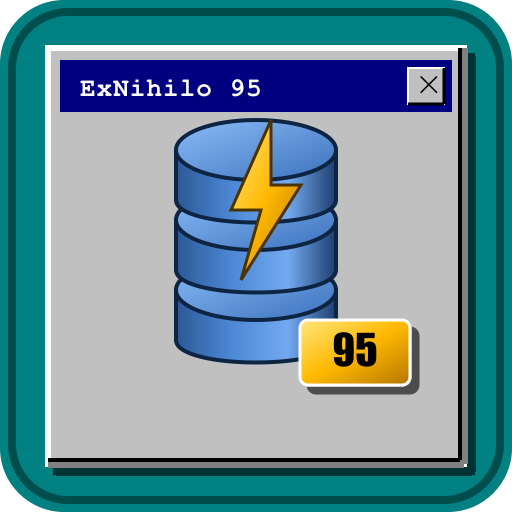
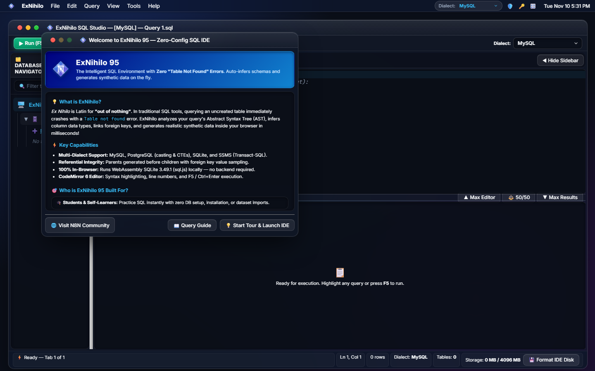
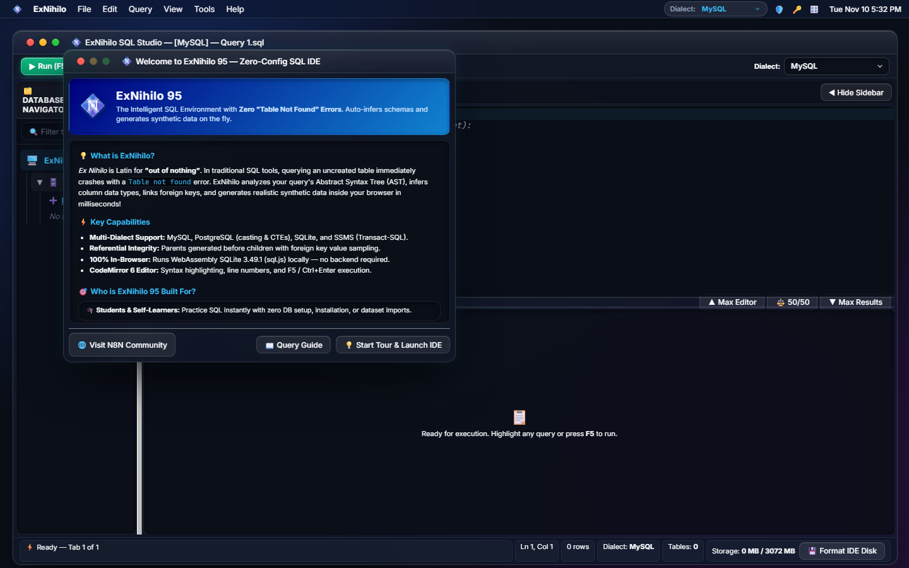
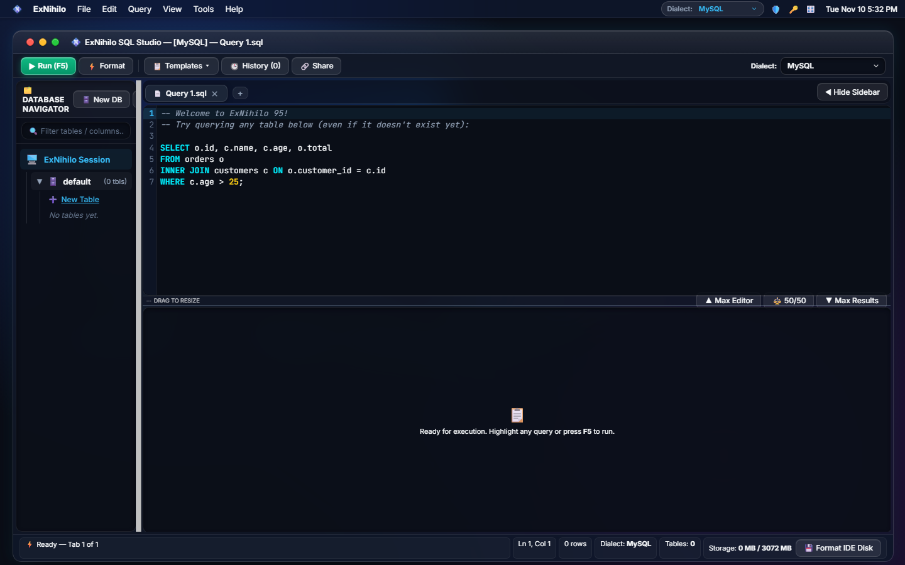
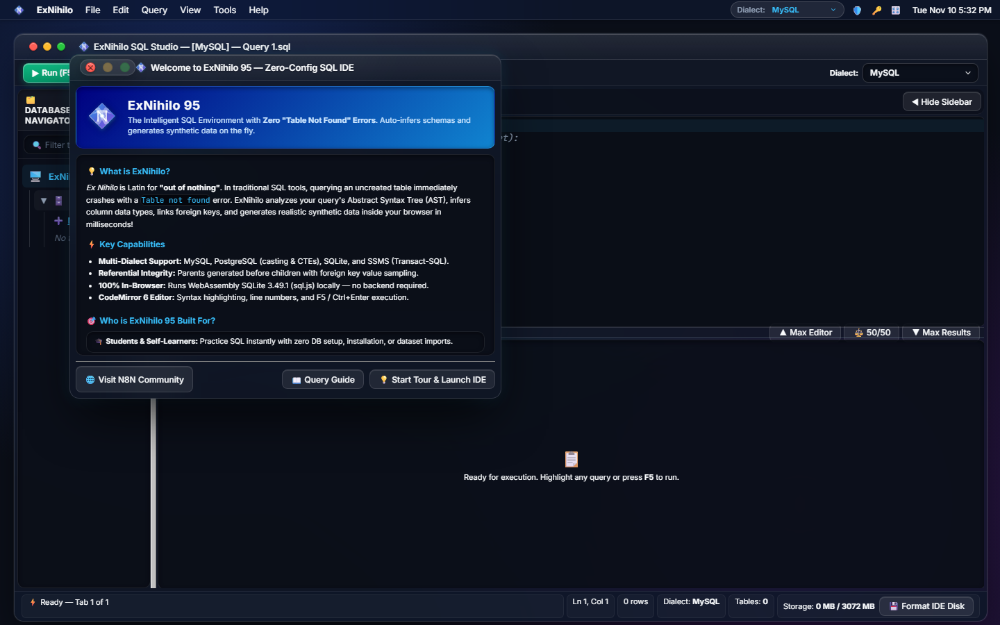
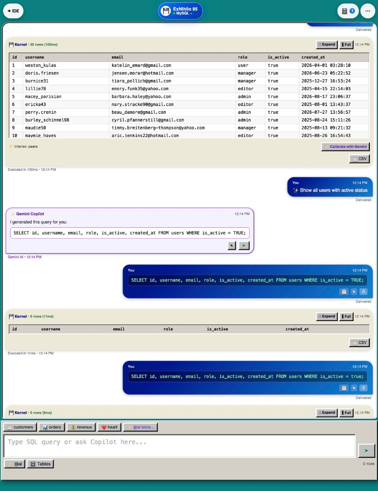
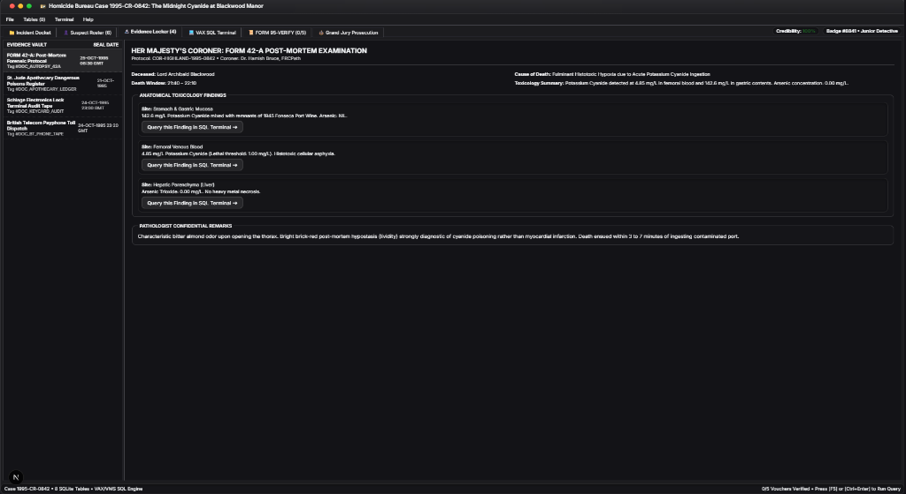
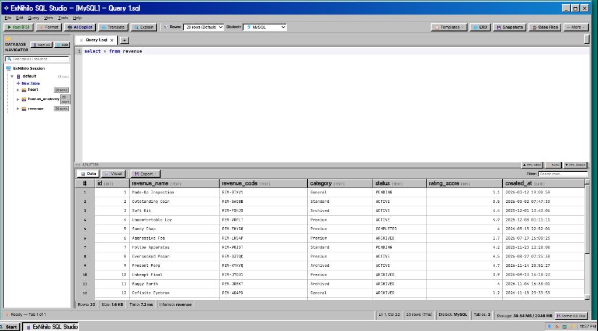
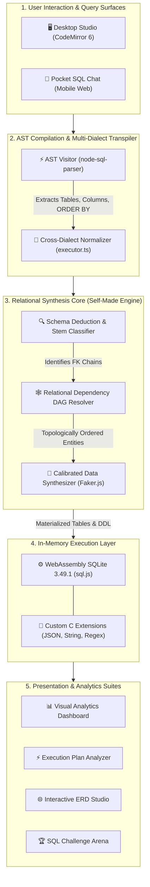

<p align="center">
  
  <h1 align="center">🗄️ ExNihilo 95</h1>
  <p align="center">
    <strong>The Zero-Config In-Browser SQL IDE & Relational Synthesis Engine</strong>
  </p>
  <p align="center">
    <em>"The only SQL database environment in the world with ZERO 'Table not found' errors — Query tables that don't even exist."</em>
  </p>
</p>

<p align="center">
  <a href="https://exnihilo-95.vercel.app">
    
  </a>
</p>

<p align="center">
  <a href="https://exnihilo-95.vercel.app"></a>
  <a href="https://github.com/Mrityunjai-hue/exnihilo-95"></a>
  <a href="https://github.com/Mrityunjai-hue/exnihilo-95"></a>
  <a href="https://github.com/Mrityunjai-hue/exnihilo-95"></a>
  <a href="https://github.com/Mrityunjai-hue/exnihilo-95"></a>
  <a href="https://sql.js.org/"></a>
  <a href="LICENSE"></a>
  <a href="#-multi-tier-licensing--open-source-governance"></a>
  <a href="#-multi-tier-licensing--open-source-governance"></a>
  <a href="COPYRIGHT_AND_INTELLECTUAL_PROPERTY.md"></a>
</p>

---

## 📑 Table of Contents

- [💡 Core Architectural Manifesto: Self-Made Engine](#-core-architectural-manifesto-self-made-engine)
- [🖼️ Visual Product Showcase: Real Screenshots](#%EF%B8%8F-visual-product-showcase-real-screenshots)
  - [🖥️ Desktop Workstations (Windows 95 Classic & Modern Glass)](#%EF%B8%8F-desktop-workstations-windows-95-classic--modern-glass)
  - [📱 Mobile Pocket SQL Chat (iMessage + Win95)](#-mobile-pocket-sql-chat-imessage--win95)
  - [🕵️‍♂️ SQL Noir: Forensic Homicide Bureau](#%EF%B8%8F%EF%B8%8F-sql-noir-forensic-homicide-bureau)
  - [📊 Executive Visual Analytics & Results Grid](#-executive-visual-analytics--results-grid)
- [✨ What Makes ExNihilo 95 Revolutionary](#-what-makes-exnihilo-95-revolutionary)
- [🌟 Flagship Features & Workstations](#-flagship-features--workstations)
  - [1. Zero-Setup Database Engine & Relational Synthesis](#1-zero-setup-database-engine--relational-synthesis)
  - [2. Universal Cross-Dialect SQL Transpiler](#2-universal-cross-dialect-sql-transpiler)
  - [3. Pocket SQL Chat (Mobile Experience)](#3-pocket-sql-chat-mobile-experience)
  - [4. 🕵️‍♂️ SQL Noir: Forensic Homicide Bureau](#4-%EF%B8%8F%EF%B8%8F-sql-noir-forensic-homicide-bureau)
  - [5. 📊 Executive Visual Analytics Dashboard](#5--executive-visual-analytics-dashboard)
  - [6. ⚡ Visual Query Execution Plan & Optimizer Analyzer](#6--visual-query-execution-plan--optimizer-analyzer)
  - [7. 🌐 Entity-Relationship Diagram (ERD Studio)](#7--entity-relationship-diagram-erd-studio)
  - [8. 🏆 SQL Challenge Arena (130 Real Interview Questions)](#8--sql-challenge-arena-130-real-interview-questions)
  - [9. 🎨 6 Nostalgic Desktop Themes & CRT Filter](#9--6-nostalgic-desktop-themes--crt-filter)
  - [10. 👤 Offline Security Keyring & User Profiles](#10--offline-security-keyring--user-profiles)
- [🧠 Engine Architecture & Systems Flowchart](#-engine-architecture--systems-flowchart)
- [⛏️ Tech Stack, APIs & Core Specifications](#%EF%B8%8F-tech-stack-apis--core-specifications)
- [🧑‍💻 Getting Started: Setup and Running Instructions](#-getting-started-setup-and-running-instructions)
- [🧪 Quality Assurance & Test Verification](#-quality-assurance--test-verification)
- [🤝 How to Contribute and Report Issues](#-how-to-contribute-and-report-issues)
- [📜 Multi-Tier Licensing & Open Source Governance](#-multi-tier-licensing--open-source-governance)
- [⚖️ Intellectual Property, Credits & License](#%EF%B8%8F-intellectual-property-credits--license)

---

## 💡 Core Architectural Manifesto: Self-Made Engine

> ### 📢 Important Architectural Distinction:
> **ExNihilo 95 is NOT an AI/LLM wrapper or API proxy.**  
> Every single database mechanism in ExNihilo 95 is our **own unique, original, self-made client-side engine**, conceived, designed, and coded from the ground up:
> - **The AST Deduction Engine:** Our proprietary recursive visitor extracts table entities, alias scopes, column references, and `ORDER BY`/`GROUP BY` metrics directly from raw SQL statements.
> - **The Relational DAG Dependency Sorter:** Automatically discovers implied foreign key hierarchies (`{parent}_id` ➔ `parent.id`) and executes topological graph sorting so parent tables are materialized before children.
> - **The Morphological Stem Classifier & Omni-Domain Knowledge Base (OSI 500+):** Maps linguistic stems across biometrics, astronomy, physics, logistics, fintech, geology, and medicine without external calls.
> - **The Universal Multi-Dialect Transpiler:** Normalizes T-SQL, Oracle, Postgres, and MySQL dialect idioms into high-performance ANSI SQLite WebAssembly bytecodes locally.
>
> **Where is AI used?**  
> AI (**Gemini Copilot**) is integrated **strictly and solely as an optional user-facing helper/copilot** (drafting SQL queries from natural language questions, suggesting optimization tips, and offering interview coaching). Even if you are completely offline, in airplane mode, or have zero API keys, **ExNihilo's self-made engine runs 100% locally in your browser with zero performance degradation!**

---

## 🖼️ Visual Product Showcase: Real Screenshots

Every view in ExNihilo 95 is built with pixel-perfect authenticity. Below is the real product in action across desktop and mobile:

### 🖥️ Desktop Workstations (Windows 95 Classic & Modern Glass)

<p align="center">
  
</p>
<p align="center">
  <em>The complete 1995 desktop operating system with interactive taskbar, start menu, draggable desktop icons, and floating multi-window shell.</em>
</p>

<table align="center" width="100%">
  <tr>
    <td width="50%" align="center">
      <strong>💻 SQL Studio & Results Data Grid</strong><br />
      
      <p align="left"><sub>Interactive CodeMirror 6 query editor with dialect switcher, live results data grid, column sorting, and instant 1-click CSV/JSON/XLS exports.</sub></p>
    </td>
    <td width="50%" align="center">
      <strong>🏆 SQL Challenge Arena (130 Questions)</strong><br />
      
      <p align="left"><sub>130 real LeetCode & HackerRank SQL interview problems evaluated live against ephemeral in-browser WebAssembly testbeds with mismatch diffing.</sub></p>
    </td>
  </tr>
  <tr>
    <td width="50%" align="center">
      <strong>🗂️ Interactive SQL Dictionary & Schema Tree</strong><br />
      
      <p align="left"><sub>Live SQLite schema introspection tree with 2-tier responsive action bar and drag-to-resize database navigator panel.</sub></p>
    </td>
    <td width="50%" align="center">
      <strong>🪟 Authentic Windows 95 Desktop Shell</strong><br />
      
      <p align="left"><sub>Pixel-perfect 3D beveled borders, tactile system chimes, vintage CRT scanline filters, and retro system properties control panels.</sub></p>
    </td>
  </tr>
</table>

---

### 📱 Mobile Pocket SQL Chat (iMessage + Win95)

ExNihilo 95 reimagines database engineering for handheld smartphones with **Pocket SQL Chat**, blending the tactile nostalgia of Windows 95 with the fluid, curved minimalism of modern messenger platforms:

<p align="center">
  
</p>

<p align="center">
  <em><strong>Pocket SQL Chat in live action:</strong> Floating dialect switcher pill, interactive Copilot conversation bubbles, inline expandable Kernel result grids, and one-tap table selector bar.</em>
</p>

- **Floating Dialect Pill:** Switch between `SSMS`, `MySQL`, `PostgreSQL`, and `SQLite` directly inside the top status pill with zero UI displacement.
- **Curved iMessage Query Bubbles:** Sent queries, AI Copilot responses, and execution results live in a chronological, conversational stream.
- **Embedded WebAssembly Kernel Cards:** View live SQL result rows inside compact, expandable Win95 tables with inline sorting and CSV export.
- **⚡ 1-Tap Error Auto-Repair:** Tapping *Ask AI Copilot to Fix* automatically extracts the failed query, repairs syntax across dialects, and delivers the working query without hallucinations.
- **Virtual Viewport Lock:** Eliminates mobile keyboard jumping and keeps input elements pinned during typing on Safari, Chrome, and Firefox mobile.

---

### 🕵️‍♂️ SQL Noir: Forensic Homicide Bureau

<p align="center">
  
</p>
<p align="center">
  <em>The SQL Noir retro forensic investigation room: live suspect roster, audit logs, apothecary receipts, evidence lockers, and credibility stamping.</em>
</p>

- **Case 1: The Midnight Cyanide at Blackwood Manor (1995-CR-0842):** Interrogate 135+ keycard swipe logs, 45+ toxicology panels, apothecary ledgers, and phone dispatches to shatter false train alibis.
- **Case 2: The Clyde Naval Shipyard Sabotage (1995-CR-1042):** Classified nuclear propulsor blueprints stolen from Vault 4. Audit turnstile records, chemical stores, and foreign wiretaps.
- **Tactile Paperclip Audio:** Attach query result rows to case files with realistic physical metallic paperclip sound effects (`playPaperclip()`).
- **Rubber Alibi Stamps & Grand Jury Trials:** Stamp suspect statements as `VERIFIED` or `CONTRADICTED`, present Exhibits A, B, and C in High Court, strike the oak gavel, and generate extra-edition headlines.

---

### 📊 Executive Visual Analytics & Results Grid

<p align="center">
  
</p>
<p align="center">
  <em>Live query results with automated executive analytics, proportional rank bars, SVG gradient area trendlines, and schema profiler metrics.</em>
</p>

- **Instant KPI Aggregations:** Total Volume, Mean Average, Peak Maximum, and Minimum Floor calculated instantly on client side.
- **Side-by-Side Dual Visuals:** Horizontal proportional rank bars paired with SVG gradient area trendlines.
- **Schema Profiler:** Inspect completeness fill rates, distinct cardinality counts, and distribution ranges across every synthesized column.

---

## ✨ What Makes ExNihilo 95 Revolutionary

Have you ever wanted to prototype a query, practice an interview question, or experiment with complex window functions, but were stopped in your tracks by:
```
ERROR: relation "orders" does not exist
LINE 1: SELECT * FROM orders;
                      ^
```
Traditional database tools demand that you manually design schemas, write `CREATE TABLE` DDLs, define types, configure foreign keys, and write hundreds of `INSERT INTO` statements before you can write a single `SELECT` query.

**ExNihilo 95 inverts the entire paradigm:**
1. You write ANY SQL query:
   ```sql
   SELECT TOP 3 [name], [distance_light_years] 
   FROM [celestial_objects] 
   ORDER BY [distance_light_years] DESC;
   ```
2. You click **Run** (`F5` or `Ctrl+Enter`).
3. **ExNihilo's engine parses the AST in < 5ms, deduces the schema, resolves foreign keys, synthesizes calibrated dataset rows on the fly, transpiles multi-dialect syntax, and returns the query results in an interactive data grid!**

---

## 🌟 Flagship Features & Workstations

### 1. Zero-Setup Database Engine & Relational Synthesis
- **Zero Configuration:** No Docker, no PostgreSQL server, no cloud connection. Everything runs in-browser via WebAssembly SQLite (`sql.js 3.49.1`).
- **Relational Integrity Guaranteed:** When you write complex multi-table joins:
  ```sql
  SELECT u.name, o.total_amount, p.product_name
  FROM users u
  INNER JOIN orders o ON u.id = o.user_id
  INNER JOIN order_items oi ON o.id = oi.order_id
  INNER JOIN products p ON oi.product_id = p.id;
  ```
  ExNihilo’s Relational DAG detects the foreign key chains, builds all 4 tables in the correct topological sequence, and populates matching foreign key IDs so your joins return real rows.
- **Configurable Row Density:** Synthesize 20, 50, 100, or 500 rows per table with a single click.

---

### 2. Universal Cross-Dialect SQL Transpiler
Seamlessly write queries in your preferred dialect without worrying about SQLite syntax limitations:

| Selected Dialect | Syntax You Can Write | How ExNihilo Handles It |
| :--- | :--- | :--- |
| **SSMS / T-SQL** | `SELECT TOP (5) [col] FROM [tbl]` | Transpiles brackets `[col]` $\to$ `"col"` and moves `TOP n` $\to$ trailing `LIMIT n`. |
| **Oracle** | `SELECT * FROM emp WHERE ROWNUM <= 10` | Normalizes `ROWNUM <= n` expressions directly into `LIMIT n`. |
| **PostgreSQL** | `col ->> 'field'`, `ILIKE`, `::numeric` | Evaluates via registered WASM functions (`PG_JSON_EXTRACT_TEXT`). |
| **MySQL** | `GROUP_CONCAT(col SEPARATOR ',')` | Transpiles MySQL group concatenation to standard SQLite syntax. |
| **SQLite** | `strftime('%Y-%m', created_at)` | Native, zero-overhead WebAssembly execution. |

---

### 3. Pocket SQL Chat (Mobile Experience)
A fluid mobile database client combining retro Windows 95 aesthetics with contemporary iMessage ergonomics. Features full mobile keyboard stabilization, floating dialect pills, tactile result cards, and 1-tap query error repair.

---

### 4. 🕵️‍♂️ SQL Noir: Forensic Homicide Bureau
Step into the role of Lead Forensic Detective in a 1990s law enforcement bureau with live suspect interrogation, paperclip proof attachments, credibility stamping, and grand jury indictment trials.

---

### 5. 📊 Executive Visual Analytics Dashboard
Instant aggregation of Total Volume, Mean Average, Peak Maximum, Floor Minimum, proportional category distribution bars, SVG gradient area trendlines, and deep column profiler health matrix.

---

### 6. ⚡ Visual Query Execution Plan & Optimizer Analyzer
Inspect SQLite optimizer bytecodes to pinpoint bottlenecks:
- **Hierarchical Execution Tree:** Identifies `🔍 SCAN` (Sequential Table Scan), `⚡ INDEX` (Covering B-Tree Seeks), `🔄 SORT` (Temporary In-Memory Buffers), and `🔗 JOIN` operations.
- **Index Advisor:** Detects missing indexes and suggests concrete DDL optimizations (e.g. `CREATE INDEX idx_user_email ON users(email);`).
- **Complexity Scoring:** Classifies execution complexity from $O(1)$ seeks up to $O(N \log N)$ disk-spilling operations.

---

### 7. 🌐 Entity-Relationship Diagram (ERD Studio)
- **Interactive Canvas:** Draggable table windows with auto-updating Bezier curve foreign key connectors.
- **Cardinality Badges:** Clear visual indicators for One-to-Many (`1` $\rightarrow$ `∞`) relationships.
- **1-Click Relational Seeder:** Seeds pre-linked schemas (`users`, `orders`, `products`, `order_items`) for instant experimentation.

---

### 8. 🏆 SQL Challenge Arena (130 Real Interview Questions)
Sharpen your SQL skills against authentic interview problems from top tech companies:

| Category | Questions | Featured LeetCode / HackerRank Problems |
| :--- | :---: | :--- |
| **🟢 Filtering & Strings** | **42** | LC #182 (*Duplicate Emails*), LC #584 (*Customer Referee*), LC #595 (*Big Countries*) |
| **🟡 Aggregations & Grouping** | **28** | LC #511 (*Game Play I*), LC #586 (*Largest Orders*), LC #1075 (*Project Employees I*) |
| **🔵 Joins & Relational Sets** | **26** | LC #175 (*Combine Two Tables*), LC #181 (*Employees Earning More*), LC #183 (*Never Order*) |
| **🟣 Subqueries & CTEs** | **14** | LC #176 (*Second Highest Salary*), LC #184 (*Department Highest Salary*), LC #262 (*Trips*) |
| **📊 Window Functions** | **20** | LC #177 (*Nth Highest Salary*), LC #178 (*Rank Scores*), LC #185 (*Top Three Salaries*) |
| **TOTAL** | **130** | *100% Ground-Truth Verification via Ephemeral WebAssembly Test Harnesses* |

---

### 9. 🎨 6 Nostalgic Desktop Themes & CRT Filter
Switch themes dynamically via Desktop Right-Click $\rightarrow$ **Properties**:

1. **💾 Windows 95 Classic:** Authentic teal desktop (`#008080`), 3D beveled silver borders, and navy titlebars.
2. **🍎 macOS Modern (Nihilo Glass):** Frosted dark obsidian glass (`#141416`), continuous squircles, floating dock, and traffic lights.
3. **🌙 Windows Noir Midnight:** High-contrast midnight obsidian with electric cyan neon accents.
4. **🔵 Windows XP Luna:** Iconic royal blue gradients, rounded controls, and olive green highlights.
5. **🏢 Windows 2000 Corporate:** Enterprise workstation steel blue titlebars and crisp industrial panels.
6. **📺 CRT Monitor Scanline Filter:** Vintage cathode-ray phosphor glow, scanlines, and curved screen geometry.

---

### 10. 👤 Offline Security Keyring & User Profiles
- **Zero-Cloud Privacy:** Password hashing executed locally in-browser using **PBKDF2 with 600,000 rounds** via native Web Crypto APIs.
- **Retro 8-Bit Avatars:** Personalize your workstation (`💻`, `🧙‍♂️`, `💾`, `🕹️`, `⚡`, `⚙️`, `🛡️`).
- **Session Keychain:** Credentials and query histories stay encrypted on your device.

---

## 🧠 Engine Architecture & Systems Flowchart



---

## ⛏️ Tech Stack, APIs & Core Specifications

- **Frontend Architecture:** Next.js 16.3.2 (App Router & Turbopack), React 19, TypeScript 5.9.
- **Core Database Engine:** WebAssembly SQLite (`sql.js 3.49.1`), Web Workers.
- **SQL Editor:** CodeMirror 6 with custom syntax highlighting, SQL Linter, and Autocomplete.
- **Data Generation:** Faker.js + Omni-Domain Semantic Ontology (OSI 500+).
- **Styling:** Tailwind CSS + Custom 3D Retro Bevel Matrix + CSS Backdrop Filters.
- **Quality Assurance:** Vitest 4.1.11, Testing Library, TypeScript Strict Mode.

---

## 🧑‍💻 Getting Started: Setup and Running Instructions

### Prerequisites
- **Node.js:** v18.17.0 or later (Node.js 20+ recommended).
- **Package Manager:** `npm` (included with Node.js).

### 1. Clone the Repository
```bash
git clone https://github.com/Mrityunjai-hue/exnihilo-95.git
cd exnihilo-95
```

### 2. Install Dependencies
```bash
npm install
```

### 3. Configure Environment (Optional for Gemini Copilot)
Create a `.env.local` file in the project root:
```env
# Optional: Enables natural language Copilot suggestions
GEMINI_API_KEY=your_gemini_api_key_here
```
*(Note: If omitted, ExNihilo runs seamlessly using its offline semantic parser engine).*

### 4. Start Development Server
```bash
npm run dev
```
Open **[http://localhost:3000](http://localhost:3000)** in your browser to experience ExNihilo 95.

---

## 🧪 Quality Assurance & Test Verification

ExNihilo 95 enforces continuous automated test suites to guarantee database engine fidelity and UI integrity:

```bash
# Run complete Vitest suite (328 tests across 43 suites)
npm test

# Run TypeScript compilation verification (0 errors)
npm run typecheck

# Build production bundle
npm run build
```

| Suite Category | File Location | Tests | Status |
| :--- | :--- | :---: | :---: |
| **Multi-Dialect Transpiler & Dynamic Tables** | `src/tests/engine/executor_dialects.test.ts` | 7 | **100% Passed** |
| **Grid Virtualization & Interactive Sorting** | `src/tests/components/grid.test.ts` | 9 | **100% Passed** |
| **Themes Engine & 6 Retro Styles** | `src/tests/components/themes.test.ts` | 4 | **100% Passed** |
| **Detective Forensic Evaluator** | `src/tests/engine/detective_evaluator.test.ts` | 6 | **100% Passed** |
| **Challenge Arena WASM Evaluator** | `src/tests/engine/challenge_evaluator.test.ts` | 5 | **100% Passed** |
| **Relational Joins (INNER, LEFT, RIGHT)** | `src/tests/engine/joins.test.ts` | 4 | **100% Passed** |
| **Window Functions & Partitioning** | `src/tests/engine/window.test.ts` | 9 | **100% Passed** |
| **Database Session State Manager** | `src/tests/engine/db_manager.test.ts` | 22 | **100% Passed** |
| **Omni-Domain Synthesis (OSI 500+)** | `src/tests/engine/omni_domain_500_synthesis.test.ts` | 6 | **100% Passed** |
| **Remaining Core Engines & Components** | `src/tests/...` (34 additional files) | 256 | **100% Passed** |
| **TOTAL VERIFIED TEST SUITE** | **43 Test Suites** | **328** | **🟢 100% PASSED** |

---

## 🤝 How to Contribute and Report Issues

We welcome contributions, bug reports, and suggestions from fellow engineers and SQL enthusiasts!

### Reporting Bugs or Requesting Features
- Please open an issue on the [GitHub Issues Page](https://github.com/Mrityunjai-hue/exnihilo-95/issues).
- For query execution bugs, please provide the SQL statement, selected dialect, and the expected vs. actual output.

### Submitting Pull Requests
1. Fork the repository.
2. Create a feature branch: `git checkout -b feature/amazing-feature`.
3. Commit your changes: `git commit -m "feat: add amazing feature"`.
4. Ensure all tests pass: `npm test && npm run typecheck`.
5. Push to your branch and open a Pull Request.

---

## 📜 Multi-Tier Licensing & Open Source Governance

To safeguard the original engineering, design assets, and community data while remaining open for developers, ExNihilo 95 operates under a clear, multi-faceted open source licensing framework:

| Component Scope | Governing License | Terms & Permissions |
| :--- | :--- | :--- |
| **Application Source Code** | **MIT License with Attribution** | Permissive open-source code use. Modification, distribution, and private use are granted provided original copyright notices and author credit to Mrityunjai are preserved. |
| **Creative Assets & UI Artwork** | **Creative Commons CC BY 4.0** | Applies to retro 8-bit icons, audio sound effects, graphic design assets, forensic case narratives, and documentation. You may share and adapt with visible attribution. |
| **Schemas & Challenge Datasets** | **ODC-By v1.0 (Open Data Commons)** | Applies to the 130 LeetCode & HackerRank challenge question sets and simulated domain catalog specifications. Free to use, adapt, and distribute with attribution. |
| **Patent & Non-Theft Covenant** | **Apache 2.0 Patent Grant Clause** | Contributors and distributors grant users an express, perpetual, irrevocable patent license for all self-made relational synthesis algorithms. Deceptive re-branding is strictly barred. |

---

## ⚖️ Intellectual Property, Credits & License

- **Creator & Lead Architect:** **Mrityunjai** ([@Mrityunjai-hue](https://github.com/Mrityunjai-hue))
- **Live Deployment:** [https://exnihilo-95.vercel.app](https://exnihilo-95.vercel.app)
- **Community:** [N8N Data Science Community](https://n8n-ds-community.netlify.app/)
- **License Documents:**
  - Code License: [LICENSE](LICENSE)
  - Anti-Theft & IP Notice: [COPYRIGHT_AND_INTELLECTUAL_PROPERTY.md](COPYRIGHT_AND_INTELLECTUAL_PROPERTY.md)

<p align="center">
  <sub>Designed with relentless craftsmanship by Mrityunjai. If you find ExNihilo 95 useful, please star ⭐ the repository!</sub>
</p>
